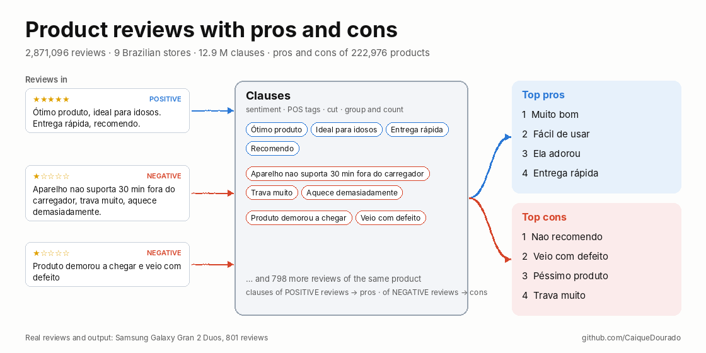

# pros-e-contras-ptbr

[](https://github.com/CaiqueDourado/pros-e-contras-ptbr/actions/workflows/tests.yml)
[](LICENSE)
[](https://www.kaggle.com/datasets/caiquedourado/reviews-produtos-ptbr)

[Leia em português](README.pt-BR.md)



Top **pros and cons** of a product from its reviews in Brazilian Portuguese. No API, no model download. It cuts each review into clauses, scores each clause with a lexicon learned from 11.7 million clauses of real reviews, groups clauses that say the same thing, and lists the most repeated ones.

```python
from pros_e_contras import Review, summarize

reviews = [
    Review(1, "Ótimo produto, entrega rápida."),
    Review(2, "Ótimo produto, muito bonito!"),
    Review(3, "A entrega foi rápida, mas não funciona. Fora isso, não recomendo."),
    Review(4, "Não funciona e trava muito. Não recomendo"),
]
s = summarize(reviews)
[i.clause for i in s.pros]   # ['Ótimo produto', 'A entrega foi rápida', 'Entrega rápida', 'Muito bonito']
[i.clause for i in s.cons]   # ['Não recomendo', 'Não funciona', 'Trava muito']
```

Review 3 is negative, but its clause "A entrega foi rápida" is praise, so it goes to the pros. The filler "Fora isso" goes nowhere. In 2020 both would have been cons; fixing that is the reason this library exists.

## Where it comes from

In 2020 the author's review sites showed the 4 pros and 4 cons of each product, computed from 2.87 million reviews collected from 9 Brazilian stores. The method, from his presentation *"Divisão de Sentenças + Análise de sentimentos = Prós e Contras"*:

1. **Sentiment of each review** from AWS Comprehend.
2. **Tag every word** with the Stanford POS tagger (Portuguese model).
3. **Cut into clauses** at punctuation and conjunctions, keeping *que, se, como, quando…* inside.
4. **Group and count** clauses that share a phonetic or fingerprint key.
5. **Show the top 4** clauses of the positive reviews as pros and of the negative reviews as cons.

All of it is published in the [reviews-produtos-ptbr](https://github.com/CaiqueDourado/reviews-produtos-ptbr) dataset. The data quality report lists what went wrong. The library keeps the method, available as `mode="2020"`, and changes the parts that failed:

| | 2020 | this library (`mode="clause"`, default) |
|---|---|---|
| Cut | Stanford tagger + rule | the same rule, with no tagger: punctuation and a list of conjunctions ([article](docs/article-clause-splitting.md)) |
| Polarity | the whole review's AWS label | each clause, from a lexicon learned on the dataset, with negation ("não funciona" ≠ "funciona") |
| Mixed reviews | ignored | used, clause by clause |
| Fillers ("No mais", "O box") | counted as opinions | dropped: no opinion word, or in a list of discourse markers |
| Grouping | any of six keys; the fingerprint joined "ótima qualidade" with "péssima qualidade" | same words after accents, plurals and stopwords; negations kept |
| Ranking | clause count, ties broken toward the most common phrase on the site | distinct reviews, then strength of the opinion |

## Results

The 51 products held out of the lexicon training, with their 2020 pros and cons as published and the library's, both on the same 2020 clauses. Every listed clause was labelled *right*, *wrong side* or *no opinion* ([labels](evaluation/gold_labels.csv)).

| | right | wrong side | no opinion | right per product |
|---|---:|---:|---:|---:|
| 2020 pros | 97.1% | 0.5% | 2.5% | 3.88 |
| library pros | **99.5%** | 0.0% | 0.5% | **3.98** |
| 2020 cons | 64.7% | 9.3% | 26.0% | 2.59 |
| library cons | **89.7%** | 2.5% | 7.8% | **3.59** |

Pros were already good in 2020: most reviews are positive, so the top 4 are "Muito bom", "Ótimo produto". The gain is in the cons. One example is a DVD box set (group 438988, 1,226 reviews):

| 2020 cons | library cons |
|---|---|
| No mais · Ainda assim · O box · Desta forma | Rasga a toa · Também venho para reclamar sobre o produto ter vindo com defeito · A capa do box veio rasgada · De descobrir o que virá em seguida |

The library has its own failure: the last clause comes from "ansiosa de descobrir o que virá em seguida" ("can't wait to find out what comes next"), a positive clause that the lexicon reads as negative. And when a product has few repeated complaints, the 4 cons slots fill with single long clauses (median 8.5 words, against 2 in 2020). Use `min_mentions=2` to list only clauses found in two or more reviews: cons drop to 2 per product with 89.4% right.

The labels were written by Claude (Anthropic's model), clause by clause, and are in the repository for anyone to check; there is no second annotator yet. No LLM generated the summaries being judged. To reproduce, run `python evaluation/evaluate.py <sample folder>` ([results](evaluation/results/summary.json)).

## Install and use

```bash
pip install "pros-e-contras-ptbr @ git+https://github.com/CaiqueDourado/pros-e-contras-ptbr"
```

```bash
pros-e-contras split "Bonito, mas trava muito e esquenta. Não recomendo!"
# ["Bonito", "trava muito", "esquenta", "Não recomendo"]

pros-e-contras score "Não funciona" "Entrega rápida" "Fora isso"
# -3.35   negative  Não funciona
# +4.20   positive  Entrega rápida
# -0.87   neutral   Fora isso

pros-e-contras summarize reviews.csv --text-column text --group-column product_id > pros_cons.csv
```

| Function | What it does |
|---|---|
| `split(text, tagger=None)` | clauses of a text; `tagger=spacy_tagger("pt_core_news_sm")` cuts with spaCy's tags instead of the rule |
| `split_tagged(parse_tagged("word/TAG …"))` | the exact 2020 cut over text already tagged (the `tagged` column of the dataset) |
| `score(clause)`, `label(clause)` | sum of the lexicon weights; `positive`, `negative` or `neutral` (threshold 1.5) |
| `opinion_key(clause)`, `canonical_forms(clauses)` | the grouping key and the chosen spelling of each group |
| `summarize(reviews, mode="clause", top=4, min_mentions=1)` | the pros and cons; `mode="2020"` uses each review's `sentiment` |

The lexicon is the file [`data/lexicon.tsv`](src/pros_e_contras/data/lexicon.tsv) (6,854 words, with their counts). It was learned by [`tools/learn_lexicon.py`](tools/learn_lexicon.py) from the full dataset:

- clauses of 4–5 star reviews against clauses of 1–2 star reviews;
- weight = smoothed log-odds;
- kept only with z ≥ 4 and |weight| ≥ 0.7;
- the words after a negation counted apart as `NOT_word`.

The word counts are in [`tools/word_counts.tsv`](tools/word_counts.tsv), so the lexicon can be rebuilt with other cut-offs. Pass your own lexicon to `summarize(..., lexicon=load_lexicon("my.tsv"))` for another domain.

## Limits

- The lexicon knows words, not sentences. Sarcasm, double negation ("não tem como não se apaixonar"), and complaints written without opinion words ("Troca de lâmpadas") go wrong. Words whose side depends on the product end up neutral: "esquenta" (heats up) is a con for a phone and the point of a kettle.
- It was learned from product reviews from 2008–2019, so it leans to that vocabulary. Words about delivery and the store also count: "Entrega rápida" is a pro.
- The clause cut is the 2020 one, so "e" joining two nouns still cuts ("entre a gaveta" · "a estrutura").
- Grouping is exact after normalisation. "Muito bom" and "Produto muito bom" stay separate, as in 2020.

## Articles

- [Splitting reviews into clauses: Google Cloud NL, Stanford, and 15 lines of rules](docs/article-clause-splitting.md) ([PT](docs/artigo-divisao-de-clausulas.md))
- [Pros and cons from reviews: what the 2020 method got wrong](docs/article-pros-and-cons.md) ([PT](docs/artigo-pros-e-contras.md))
- [Case study: É bom? Vale a pena?](https://github.com/CaiqueDourado/reviews-produtos-ptbr/blob/main/docs/case-study-e-bom-vale-a-pena.md), the review site the data was collected for

## Related

- [reviews-produtos-ptbr](https://github.com/CaiqueDourado/reviews-produtos-ptbr) ([Kaggle](https://www.kaggle.com/datasets/caiquedourado/reviews-produtos-ptbr)): the 2.87 million reviews, the 2020 clauses, and the pros and cons this library is measured against.
- [DedupKit](https://github.com/CaiqueDourado/DedupKit): the normalisation, plural and matching keys used here.
- [catalogo-produtos-ecommerce-brasil](https://github.com/CaiqueDourado/catalogo-produtos-ecommerce-brasil): the products the reviews belong to.

## License

Code and lexicon: [MIT](LICENSE). Author: **Caique Dourado** ([github.com/CaiqueDourado](https://github.com/CaiqueDourado)).
