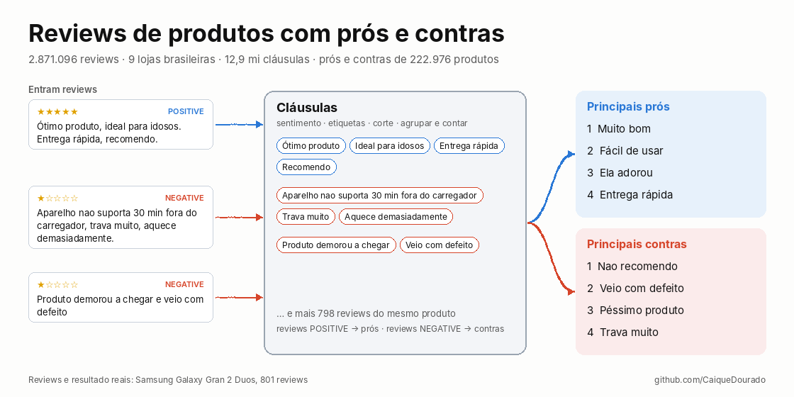
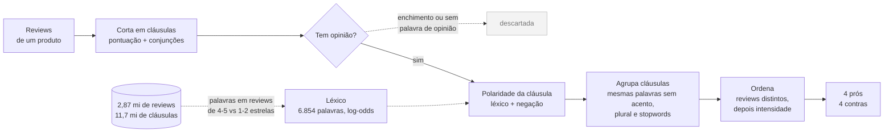

# pros-e-contras-ptbr

[](https://github.com/CaiqueDourado/pros-e-contras-ptbr/actions/workflows/tests.yml)
[](LICENSE)
[](https://www.kaggle.com/datasets/caiquedourado/reviews-produtos-ptbr)

[Read in English](README.md)



Os principais **prós e contras** de um produto a partir dos reviews em português. Funciona sem API e sem baixar modelo.

A biblioteca corta cada review em cláusulas e dá uma nota a cada cláusula com um léxico aprendido em 11,7 milhões de cláusulas de reviews reais. Depois junta as cláusulas que dizem a mesma coisa e lista as mais repetidas.

```python
from pros_e_contras import Review, summarize

reviews = [
    Review(1, "Ótimo produto, entrega rápida."),
    Review(2, "Ótimo produto, muito bonito!"),
    Review(3, "A entrega foi rápida, mas não funciona. Fora isso, não recomendo."),
    Review(4, "Não funciona e trava muito. Não recomendo"),
]
s = summarize(reviews)
[i.clause for i in s.pros]   # ['Ótimo produto', 'A entrega foi rápida', 'Entrega rápida', 'Muito bonito']
[i.clause for i in s.cons]   # ['Não recomendo', 'Não funciona', 'Trava muito']
```

O review 3 é negativo, mas a cláusula "A entrega foi rápida" é um elogio e vai para os prós. "Fora isso" não tem opinião e fica de fora. Em 2020 as duas teriam virado contras, e corrigir isso é o motivo desta biblioteca.

## De onde vem

Em 2020, os sites de reviews do autor mostravam 4 prós e 4 contras de cada produto. Eles eram calculados a partir de 2,87 milhões de reviews coletados de 9 lojas brasileiras. O método, da apresentação *"Divisão de Sentenças + Análise de sentimentos = Prós e Contras"*, tinha cinco passos:

1. **Sentimento de cada review**, dado pelo AWS Comprehend.
2. **Etiqueta gramatical de cada palavra**, dada pelo Stanford POS Tagger com modelo em português.
3. **Corte em cláusulas** na pontuação e nas conjunções. *Que, se, como, quando…* ficam dentro da cláusula.
4. **Agrupar e contar** as cláusulas que têm uma chave fonética ou de fingerprint em comum.
5. **Mostrar as 4 mais citadas**: as cláusulas dos reviews positivos viram prós, e as dos negativos viram contras.

Tudo isso está publicado na base [portuguese-product-reviews](https://github.com/CaiqueDourado/portuguese-product-reviews), e o relatório de qualidade da base lista o que deu errado. A biblioteca mantém o método original como `mode="2020"` e troca as partes que falharam:

| | 2020 | esta biblioteca (`mode="clause"`, padrão) |
|---|---|---|
| Corte | Stanford + regra | a mesma regra sem etiquetador: pontuação e uma lista de conjunções ([artigo](docs/artigo-divisao-de-clausulas.md)) |
| Polaridade | rótulo da AWS para o review inteiro | uma nota por cláusula, de um léxico aprendido na base, com negação ("não funciona" ≠ "funciona") |
| Reviews mistos | ignorados | usados, cláusula por cláusula |
| Enchimento ("No mais", "O box") | contado como opinião | descartado: não tem palavra de opinião ou está na lista de marcadores |
| Agrupamento | qualquer uma de seis chaves; o fingerprint juntava "ótima qualidade" e "péssima qualidade" | as mesmas palavras, ignorando acentos, plurais e stopwords; negações mantidas |
| Ordem | número de cláusulas; no empate, a frase mais comum no site | reviews distintos e, no empate, a força da opinião |

## Como funciona



O léxico é aprendido uma vez, a partir da [base de reviews](https://github.com/CaiqueDourado/portuguese-product-reviews), e vem junto com o pacote (`data/lexicon.tsv`). Como cada etapa foi escolhida: [divisão em cláusulas](docs/artigo-divisao-de-clausulas.md) e [prós e contras](docs/artigo-pros-e-contras.md).

## Resultados

A avaliação usa os 51 produtos que ficaram fora do treino do léxico. Para cada um, compara os prós e contras de 2020 (como foram publicados) com os da biblioteca, calculados sobre as mesmas cláusulas de 2020. Cada cláusula listada foi rotulada como *certa*, *lado errado* ou *sem opinião* ([rótulos](evaluation/gold_labels.csv)).

| | certa | lado errado | sem opinião | certas por produto |
|---|---:|---:|---:|---:|
| prós 2020 | 97,1% | 0,5% | 2,5% | 3,88 |
| prós da biblioteca | **99,5%** | 0,0% | 0,5% | **3,98** |
| contras 2020 | 64,7% | 9,3% | 26,0% | 2,59 |
| contras da biblioteca | **89,7%** | 2,5% | 7,8% | **3,59** |

Os prós de 2020 já eram bons, porque a maioria dos reviews é positiva e os 4 primeiros são "Muito bom" e "Ótimo produto". O ganho está nos contras. Um exemplo é um box de DVDs (grupo 438988, 1.226 reviews):

| contras 2020 | contras da biblioteca |
|---|---|
| No mais · Ainda assim · O box · Desta forma | Rasga a toa · Também venho para reclamar sobre o produto ter vindo com defeito · A capa do box veio rasgada · De descobrir o que virá em seguida |

A biblioteca também erra. O último contra do exemplo vem de "ansiosa de descobrir o que virá em seguida", uma frase positiva que o léxico leu como negativa.

Quando um produto tem poucas reclamações repetidas, as 4 vagas de contras são preenchidas com cláusulas longas citadas uma vez só. A mediana é de 8,5 palavras, contra 2 em 2020. Com `min_mentions=2`, só entram cláusulas que aparecem em dois reviews ou mais: ficam 2 contras por produto, com 89,4% certos.

Os rótulos foram feitos pelo Claude (modelo da Anthropic), cláusula por cláusula, e estão no repositório para conferência; ainda não há um segundo anotador. Nenhum LLM gerou os resumos avaliados. Para reproduzir: `python evaluation/evaluate.py <pasta da amostra>` ([resultados](evaluation/results/summary.json)).

## Instalar e usar

```bash
pip install "pros-e-contras-ptbr @ git+https://github.com/CaiqueDourado/pros-e-contras-ptbr"
```

```bash
pros-e-contras split "Bonito, mas trava muito e esquenta. Não recomendo!"
# ["Bonito", "trava muito", "esquenta", "Não recomendo"]

pros-e-contras score "Não funciona" "Entrega rápida" "Fora isso"
# -3.35   negative  Não funciona
# +4.20   positive  Entrega rápida
# -0.87   neutral   Fora isso

pros-e-contras summarize reviews.csv --text-column text --group-column product_id > pros_cons.csv
```

| Função | O que faz |
|---|---|
| `split(text, tagger=None)` | corta o texto em cláusulas; com `tagger=spacy_tagger("pt_core_news_sm")`, o corte segue as etiquetas do spaCy |
| `split_tagged(parse_tagged("palavra/TAG …"))` | o corte exato de 2020, sobre texto já etiquetado (a coluna `tagged` da base) |
| `score(clause)`, `label(clause)` | soma dos pesos do léxico; `positive`, `negative` ou `neutral` (limiar 1,5) |
| `opinion_key(clause)`, `canonical_forms(clauses)` | a chave de agrupamento e a grafia escolhida para cada grupo |
| `summarize(reviews, mode="clause", top=4, min_mentions=1)` | os prós e contras; `mode="2020"` usa o `sentiment` de cada review |

O léxico é o arquivo [`data/lexicon.tsv`](src/pros_e_contras/data/lexicon.tsv), com 6.854 palavras e suas contagens. Foi aprendido pelo [`tools/learn_lexicon.py`](tools/learn_lexicon.py) na base completa:

- compara as cláusulas de reviews de 4 e 5 estrelas com as de 1 e 2 estrelas;
- o peso de cada palavra é o log-odds suavizado;
- entram só as palavras com z ≥ 4 e |peso| ≥ 0,7;
- as palavras depois de uma negação contam à parte, como `NOT_palavra`.

As contagens estão em [`tools/word_counts.tsv`](tools/word_counts.tsv), para refazer o léxico com outros cortes. Para outro domínio, passe seu próprio léxico: `summarize(..., lexicon=load_lexicon("meu.tsv"))`.

## Limites

- O léxico conhece palavras, não frases. Erra em ironia, em dupla negação ("não tem como não se apaixonar") e em reclamações escritas sem palavras de opinião ("Troca de lâmpadas").
- Palavras cujo lado depende do produto acabam neutras: "esquenta" é defeito num celular e é a função de uma chaleira.
- Foi aprendido em reviews de 2008 a 2019 e puxa para esse vocabulário. Palavras sobre entrega e loja também contam: "Entrega rápida" é pró.
- O corte é o de 2020. Um "e" entre dois substantivos ainda corta ("entre a gaveta" · "a estrutura").
- O agrupamento é exato depois da normalização. "Muito bom" e "Produto muito bom" ficam separados, como em 2020.

## Artigos

- [Cortar reviews em cláusulas: Google Cloud NL, Stanford e 15 linhas de regra](docs/artigo-divisao-de-clausulas.md) ([EN](docs/article-clause-splitting.md))
- [Prós e contras a partir de reviews: o que o método de 2020 errou](docs/artigo-pros-e-contras.md) ([EN](docs/article-pros-and-cons.md))
- [Estudo de caso: É bom? Vale a pena?](https://github.com/CaiqueDourado/portuguese-product-reviews/blob/main/docs/estudo-de-caso-e-bom-vale-a-pena.md), o site para o qual os dados foram coletados

## Relacionados

- [portuguese-product-reviews](https://github.com/CaiqueDourado/portuguese-product-reviews) ([Kaggle](https://www.kaggle.com/datasets/caiquedourado/reviews-produtos-ptbr)): os 2,87 milhões de reviews, as cláusulas de 2020 e os prós e contras usados como comparação.
- [DedupKit](https://github.com/CaiqueDourado/DedupKit): a normalização, o singular e as chaves de casamento usados aqui.
- [brazilian-ecommerce-products](https://github.com/CaiqueDourado/brazilian-ecommerce-products): os produtos a que os reviews pertencem.

## Licença

Código e léxico: [MIT](LICENSE). Autor: **Caique Dourado** ([github.com/CaiqueDourado](https://github.com/CaiqueDourado)).
